# Module 1 Group Assignment

CSCI 5117, Fall 2026, [assignment description](https://canvas.umn.edu/courses/579310/pages/project-1)

## App Info:

* Team Name: HARMless
* App Name: Mixtape
* App Link: https://harmless-mixtape.onrender.com

### Students

* Amelia Vrieze, vriez051@umn.edu
* Rezky Dwisantika, dwisa001@umn.edu
* Hema Poojitha Chandu, chand968@umn.edu
* Mayli Winters, winte928@umn.edu

## Key Features

**Describe the most challenging features you implemented
(one sentence per bullet, maximum 4 bullets):**

* **Spotify API integration:** Adapting the authorization token example code to work with Flask, refreshing authorization tokens.
* **Uploading images:** Storing images in a bytea column in PostgreSQL and retrieving them to display as an image again.
* **Drag to reorder:** changing the position of tracks through drag and drop interaction, saving the updated position in the database.
* **Search:** PostgreSQL full-text search with weighted fields (title, then tags and creator, then description and songs), word-stem matching, and ranked results.

## Testing Notes

**Is there anything special we need to know in order to effectively test your app?**

* **Log in** with Google or email/password. Email/password accounts must click the verification link from Auth0 before they can log in. Logging in with Google and with email/password using the same verified email reaches the same Mixtape account.
* **Without logging in** you can browse the home page, filter by tags, search, open any mixtape, and export its song list. Creating, editing, remixing require logging in.
* **Username:** on your first login you'll pick a public username (3–20 letters, numbers or `_`; checked live as you type). You can change it later under **Profile** → Edit profile.
* **Create a mixtape** with **Add Mixtape**: Click the cover to upload your own image (PNG, JPG, GIF or WebP, up to 5 MB); otherwise the first song's album art is used.
* Only the **creator** can edit or delete a mixtape. On someone else's mixtape you can **Remix** it (save your own copy, linked as "Remixed from ...") or **save** it with the bookmark icon; saved mixtapes appear on your Profile.
* **Export** (share icon on a mixtape) downloads its song list as a text file.

## Screenshots of Site

**[Add a screenshot of each key page (around 4)](https://stackoverflow.com/questions/10189356/how-to-add-screenshot-to-readmes-in-github-repository)
along with a very brief caption:**

## Mock-up 
**Mixtape:**
[Link to Figma](https://www.figma.com/design/gbpX9Qh82GEYrpzjKzrwg2/5117--HARMless?node-id=0-1&t=v8DBNMLFY3cpP2J9-1)

<!-- There are a few tools for mock-ups. Paper prototypes (low-tech, but effective and cheap), Digital picture edition software (gimp / photoshop / etc.), or dedicated tools like moqups.com (I'm calling out moqups here in particular since it seems to strike the best balance between "easy-to-use" and "wants your money" -- the free teir isn't perfect, but it should be sufficient for our needs with a little "creative layout" to get around the page-limit)

In this space please either provide images (around 4) showing your prototypes, OR, a link to an online hosted mock-up tool like moqups.com

**[Add images/photos that show your paper prototype (around 4)](https://stackoverflow.com/questions/10189356/how-to-add-screenshot-to-readmes-in-github-repository) along with a very brief caption:**
-->
<!--
**1. Guest view of the homepage**
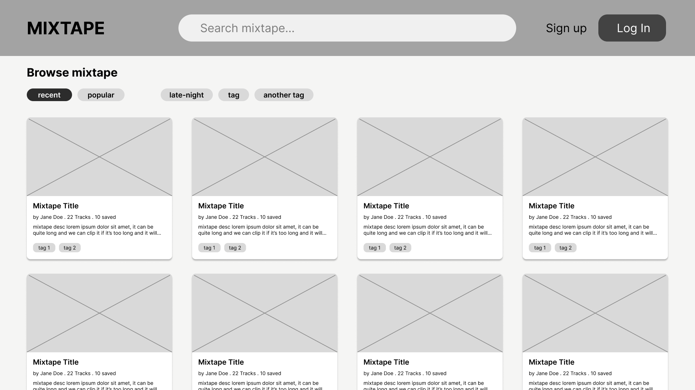
  
**2. Auth0 Sign In Page**
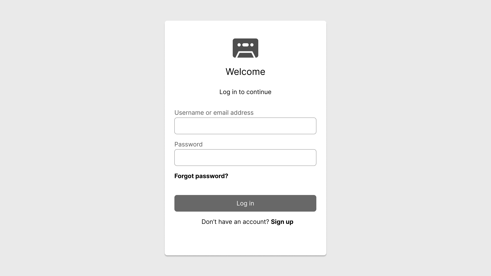
  
**3. Auth0 Sign Up Page**
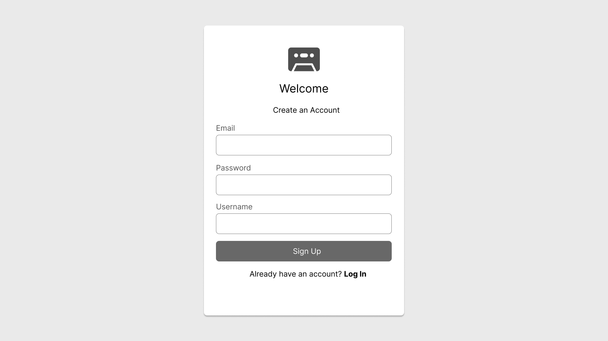
  
**4. Logged in User Homepage**
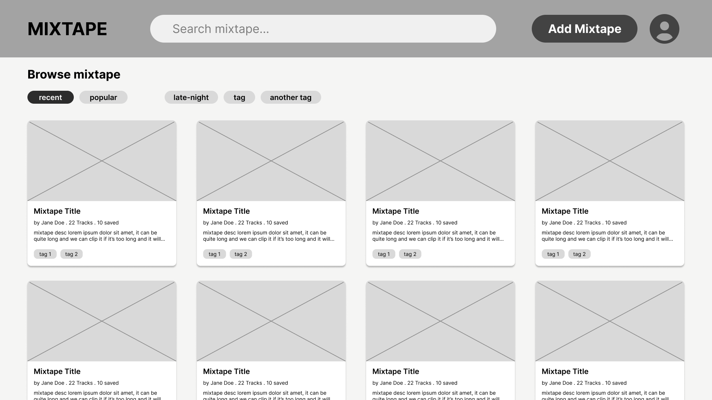
  
**5. Search Box**
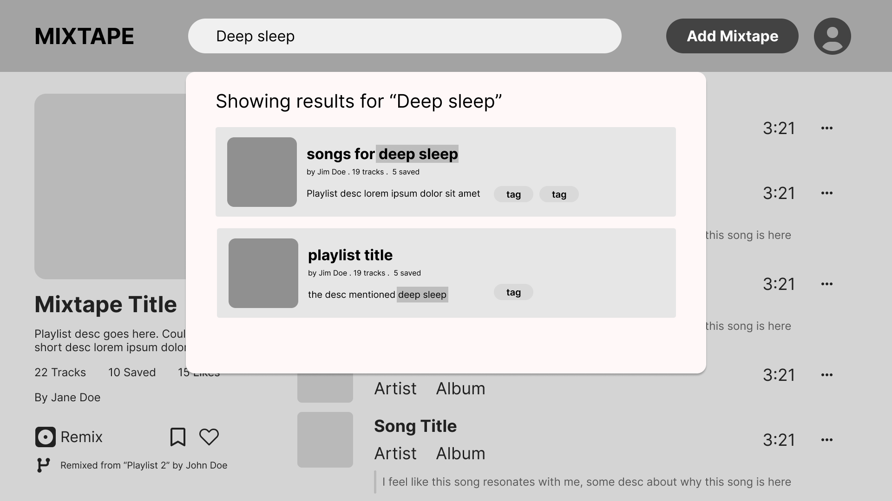
  
**6. View Other Person's Mixtape**
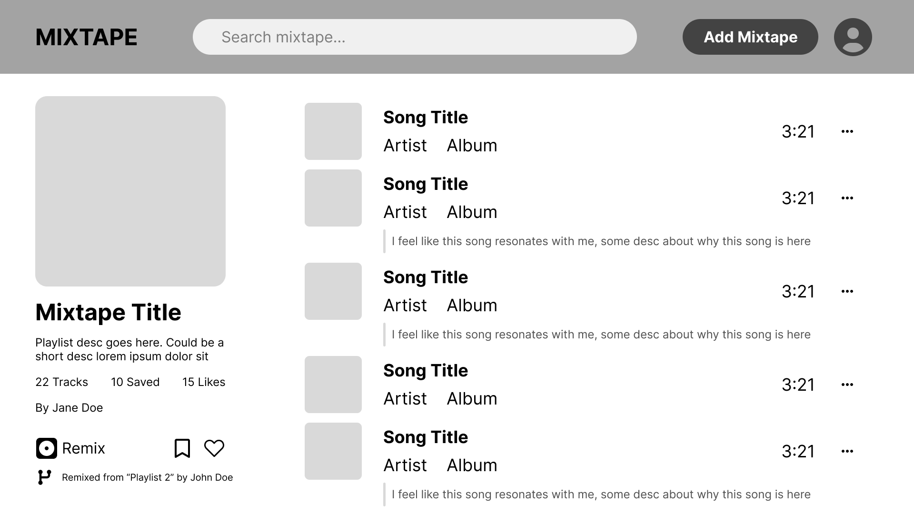
  
**7. Remix Someone Else's Mixtape**
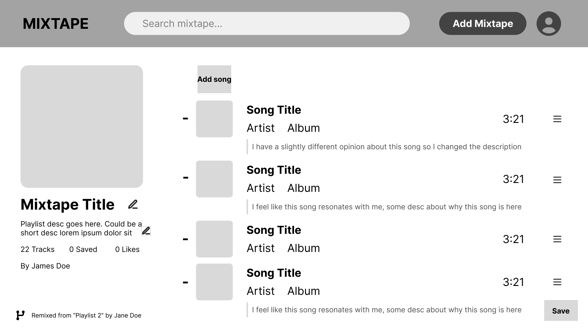
  
**8. My Account Page**
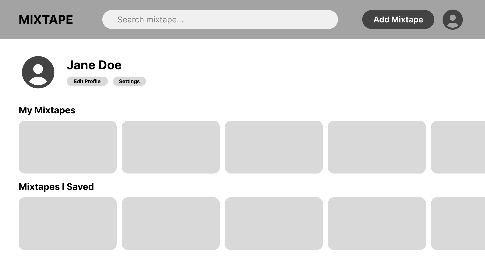
  
**9. Create a Mixtape**
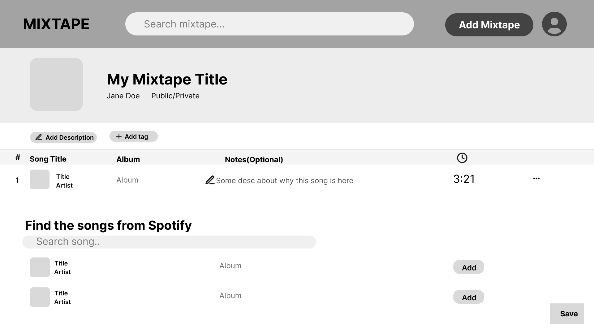
  
**10. View My Mixtape Page**
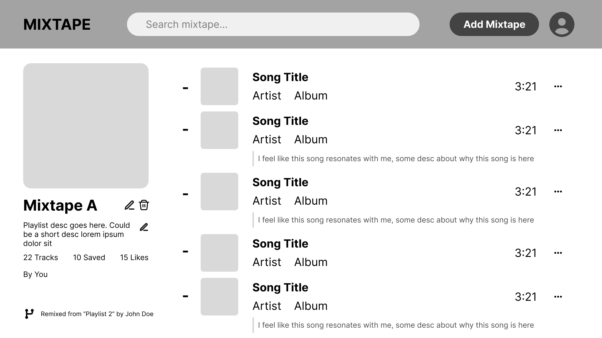
  
**11. Delete my Mixtape**
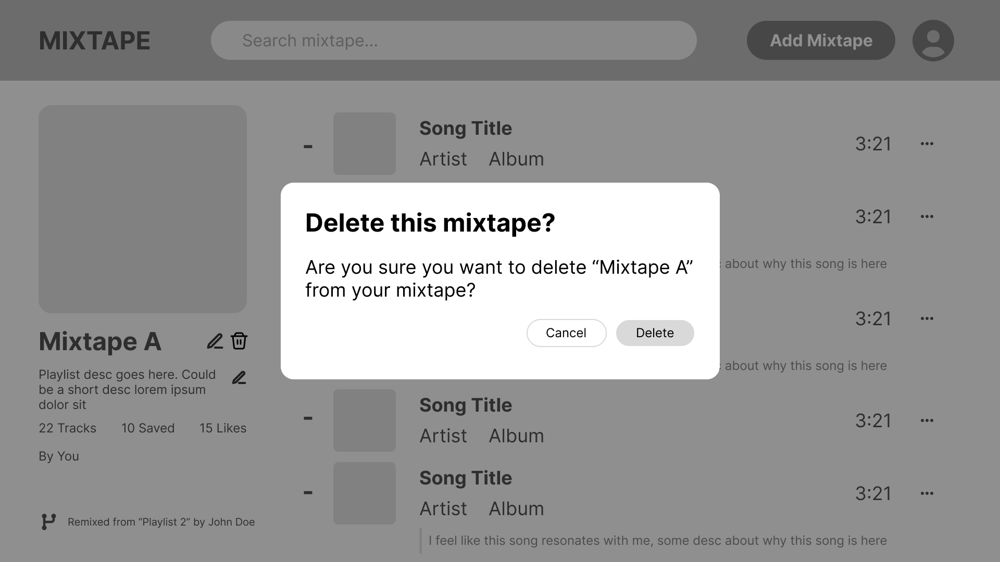
  
-->
## External Dependencies

**Document integrations with 3rd Party code or services here.
Please do not document required libraries. or libraries that are mentioned in the product requirements**

* Spotify API: Used as a source of tracks that can be added to mixtapes, retrieving information such as song title, artist, album cover image, and duration. 
* SortableJS: Used for drag and drop reordering of songs while editing mixtape.

**If there's anything else you would like to disclose about how your project
relied on external code, expertise, or anything else, please disclose that
here:**
* [The Spotify API documentation](https://developer.spotify.com/documentation/web-api) contains example code for setting up authentication that served as the basis of the Python/Flask version in our project. 
* [The SortableJS documentation](https://sortablejs.github.io/Sortable/) contains example code for implementing sortable drag and drop using SortableJS Library. 
* [The PostgreSQL full-text search documentation](https://www.postgresql.org/docs/current/textsearch-controls.html) used in our search feature, which is built on PostgreSQL's built-in full-text search (`to_tsvector`, `setweight`, `websearch_to_tsquery` and `ts_rank`) to match words across mixtape titles, tags, users, descriptions and songs, and ranks the best matches first.
